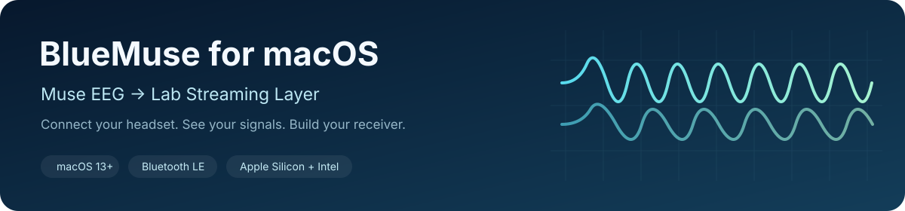
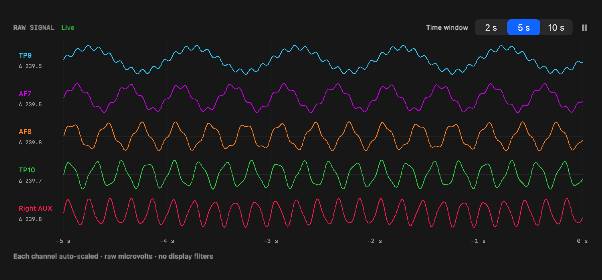

# BlueMuse for macOS — Muse EEG streaming over LSL



**macOS app to stream data from Muse EEG headsets via LSL (Lab Streaming Layer), with live signal graphs and native Bluetooth device management.**

A native SwiftUI and CoreBluetooth adaptation of [kowalej/BlueMuse](https://github.com/kowalej/BlueMuse),
originally built for Windows. Connect a Muse headband to your Mac, inspect the signals,
and stream them to an LSL receiver, LabRecorder or your own analysis software.

**Download:** open this repository's **Releases** page and choose the `.dmg` app download.
**Normal use is through the app UI—no Terminal, Python or PowerShell commands required.**

macOS 13+ · Universal Apple Silicon + Intel build · GPL-3.0 · Experimental community port



*The graph preview uses synthetic data. Physical Muse 2 acquisition has also been tested.*

## What it does

- **Muse headset discovery:** scan for nearby devices and manage streams in a native macOS UI.
- **Device profiles:** Muse 2016, Muse 2, Muse S, Muse S Athena and Smith Lowdown Focus; see the validation table below.
- Publish EEG, accelerometer, gyroscope, PPG and telemetry through Lab Streaming Layer.
- View separate channel traces with time-window and pause-display controls.
- Choose Windows-compatible or smoothed timestamp assignment.
- Configure float32/float64 samples, clock domains and optional secondary timestamps.
- Start, stop, inspect, reset and explicitly disconnect headsets; control the app through `bluemuse:` URLs.

## Download and install

Normal headset use is entirely through the app UI; no Terminal or PowerShell commands
are required. Command examples below are for source builds or optional receiver code.

Open this repository's **Releases** page and download the `.dmg` asset. Choose the
universal download for Apple Silicon or Intel. The automatic **Source code** ZIP/TAR
assets contain source, not an installer.

1. Open the DMG and drag **BlueMuse.app** to **Applications**.
2. Eject the DMG, then open BlueMuse from Applications.
3. Allow Bluetooth access and turn on your headset.

**Current downloads are unnotarized preview builds.** No Apple Developer account is
required to make or install the DMG, but macOS may block first launch because Apple
has not notarized it. If you trust the release, follow Apple's per-app **Open Anyway**
process in System Settings → Privacy & Security after attempting to open the app:
[Apple's instructions](https://support.apple.com/en-us/102445). Some managed Macs
prohibit this exception. Do not disable system-wide security protections.

The app itself requires no Python, Xcode, Homebrew or account. The universal binary
is built for both CPU architectures; Intel execution has not yet been validated.

## Build from source

Install Xcode 15+ or compatible command-line tools, then run from this folder:

```sh
bash scripts/build-app.sh
open dist/BlueMuse.app
```

The app bundles the included universal macOS liblsl framework. No Python, Homebrew,
Windows runtime or system-wide LSL install is needed to run it. You can also open
`Package.swift` in Xcode; use the built `.app` for Bluetooth permissions and URL handling.

A normal source build targets the build machine and is locally ad-hoc signed.
To build the same universal DMG used by releases:

```sh
bash scripts/package-dmg.sh
```

The builder recreates a Git-ignored `dist/` folder for generated files, including an
integrity checksum and a manifest stating signing and notarization status. Keep these
binaries out of source commits and attach the DMG/checksum/manifest to GitHub Releases. See [RELEASING.md](RELEASING.md) for GitHub Releases and future
Developer ID signing/notarization support.

## Use the app

1. Allow Bluetooth access when macOS asks.
2. Turn on the headset and keep it nearby. Close other apps connected to it.
3. Select the headset. **Start Stream** publishes enabled sensor streams and starts plots.
4. **Stop Stream** retains Bluetooth when the connection is healthy; **Disconnect**
   releases it and suppresses auto-reconnection.

## Choose timestamp behavior

Settings → **Timestamp timing** offers:

| Mode | Behavior |
| --- | --- |
| **Windows compatible — default** | Uses the supplied Windows BlueMuse timestamp-assignment rules, including legacy packet backdating and the original Athena corrector. Bluetooth arrival jitter may produce uneven or backwards timestamps. |
| **Smoothed** | Fits the host-arrival sample clock and keeps regular-stream timestamps increasing. Sensor values are unchanged; improved acquisition-time accuracy has not been established. |

Stop and restart streams after changing the setting. MUSE_4CH inherits the selected
mode, and each outlet records it in its `timestamp_behavior` metadata. Existing
preferences migrate to the Windows-compatible default while preserving other settings.

Clock domain is a separate choice: Unix epoch is calendar time; LSL clock is intended
for synchronization with other LSL sources. Selecting matching software rules does
not make different operating systems or Bluetooth hardware deliver identical timing.
See [timing details](docs/TIMING.md), including the original telemetry backdating rule.

## Headset support and validation

| Device | Implementation | Physical validation |
| --- | --- | --- |
| Muse 2 | EEG, motion, PPG, telemetry | Tested on Apple Silicon |
| Muse 2016 | Legacy protocol | Decoder fixtures; hardware not tested |
| Muse S | Legacy protocol + PPG | Decoder fixtures; hardware not tested |
| Muse S Athena | Multiplexed protocol | Experimental; decoder/timing fixtures; hardware not tested |
| Smith Lowdown Focus | Legacy profile | Decoder fixtures; hardware not tested |

Independent sessions support multiple headsets in code; simultaneous physical
headsets have not been validated. This is an experimental community port with
explicit validation limits, not a certification of 100% Windows-equivalent behavior.

The test suite includes 1,300 packet fixtures with 18,000 numeric values generated
by the unchanged upstream C# decoders, plus original-C# timestamp fixtures, settings
migration, malformed-packet handling, LSL outlet/inlet transmission and UI rendering.
See [the audit](docs/PARITY-AUDIT.md) for provenance, checks and remaining differences.

## LSL streaming details

The app publishes data. A receiver, classifier or recorder subscribes separately.
There is no account, fixed destination or cloud service. LSL peers on the local network
may discover and receive streams where networking permits.

Enabled sensors publish their own LSL streams. Configure sample precision, clock domain
and optional secondary timestamps in Settings; see [timing details](docs/TIMING.md).

### Optional four-channel EEG output

```text
Muse → BlueMuse for macOS → MUSE_4CH → receiver / classifier / recorder
```

| Property | Value |
| --- | --- |
| Name / type | `MUSE_4CH` / `EEG` |
| Order | TP9, AF7, AF8, TP10 |
| Format / units | float32 / microvolts |
| Nominal rate | 256 samples per second |
| Timestamps | Preserved from the app's EEG stream, using the selected clock and timing mode |
| Source identity | `muse_4ch_bridge_BlueMuse:<peripheral UUID>:EEG` |

**Start MUSE_4CH** starts EEG if necessary and publishes this additional output.
**Stop MUSE_4CH** closes only that output. The **ⓘ** button beside Four-channel LSL
explains stream details and provides receiver code.

To use the optional Python receiver, start the four-channel output in the app, then
run in a Terminal:

```sh
python3 -m venv .venv
.venv/bin/python -m pip install -r examples/requirements.txt
.venv/bin/python examples/receive_muse.py
```

To record rather than just receive:

```sh
.venv/bin/python examples/receive_muse.py --csv session.csv --seconds 60
```

The example refuses to overwrite an existing CSV. Its columns are `timestamp,TP9,AF7,AF8,TP10`.
For several headsets, pass `--source-id` using the identifier shown in the info panel.
Stop the receiver with Ctrl+C. Closing a receiver does not stop the headset.

A classifier belongs in the receiver: buffer samples into appropriate windows, apply
the preprocessing used during training, and pass those windows to your model. No
classifier or research recording is included. [Receiver details](docs/RECEIVERS.md).

## Test

```sh
BLUEMUSE_LSL_LIBRARY="$PWD/Vendor/lsl.framework/lsl" swift test
```

Optional: regenerate fixtures and run the upstream Athena self-check with .NET 9:

```sh
dotnet run --project Tests/BlueMuse.Parity.Tests -- Tests/BlueMuseCoreTests/Fixtures/windows-decoder-fixtures.json
dotnet run --project Tests/BlueMuse.Parity.Tests --no-restore -- --athena-self-check
```

Tests publish short-lived synthetic LSL streams and require local networking. UI
rendering tests use synthetic signals. The macOS CI workflow runs tests and builds
the app; a workflow file is not evidence of a completed remote CI run.

## Troubleshooting

- **Headset absent:** check power/range, Bluetooth permission, and competing Muse apps; refresh the list.
- **Receiver sees nothing:** press Start MUSE_4CH and confirm its sample counter advances. The normal EEG stream has a different name.
- **Multiple matching streams:** choose the source ID for the intended headset and stop any old Python republisher.
- **Telemetry appears flat:** legacy updates arrive roughly every 10 seconds. Several firmware fields are uncertain or reported as zero; they are not calibrated measurements.
- **Timing-mode change has no effect:** stop and restart the stream; active outlets keep their start-time settings.
- **Logs:** use Settings → Open Log Folder. Logs and recordings are excluded from version control.

## Project layout

```text
Sources/          Native app and portable decoding/timing core
Tests/            Swift tests, synthetic fixtures and C# fixture generator
Reference/        Unmodified upstream protocol source used to generate fixtures
Vendor/           Official macOS liblsl framework, notices and license
examples/         Receiver with optional CSV recording
scripts/          Build, DMG packaging and diagnostic tools
Resources/        Application icon
docs/             Timing, receivers, validation and preview
.github/          macOS test/build workflow
```

## Credits and license

Built from [BlueMuse by kowalej and contributors](https://github.com/kowalej/BlueMuse).
The original Windows project supplied the protocol definitions, decoding rules and
feature baseline. Its Muse/Athena implementation also credits the muse-lsl ecosystem.

This derivative is distributed under **GPL-3.0**, retaining the upstream [LICENSE](LICENSE).
The bundled **liblsl 1.17.7** has its own MIT/third-party notices in `Vendor/`.
Upstream reference hashes and adaptation notes are in [UPSTREAM.md](UPSTREAM.md).
