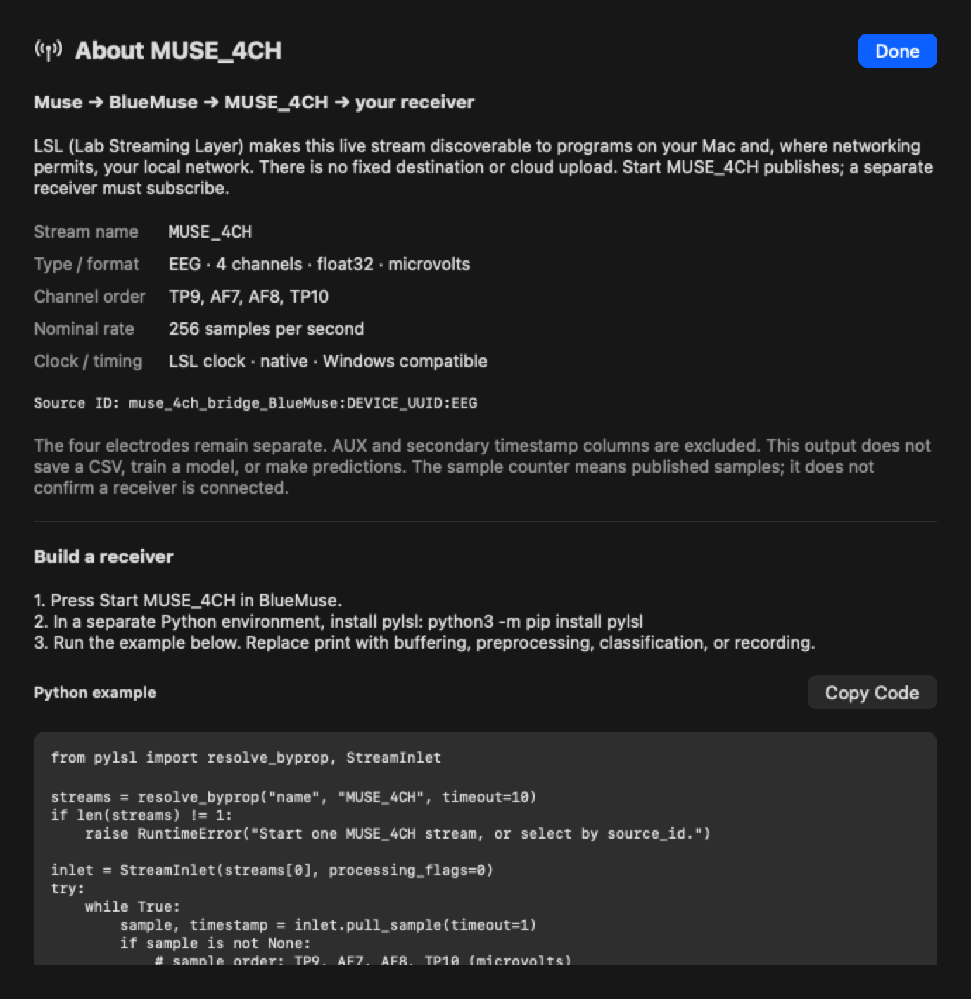

# Receiving MUSE_4CH

BlueMuse is an LSL outlet, analogous to a named live channel. It does not send to a
configured web address or file. A receiver discovers the stream and opens an inlet.
Programs on the same machine are the simplest setup; local network discovery and
reception depend on network settings and permissions.

1. Start the headset's MUSE_4CH output in BlueMuse.
2. Install pylsl in a separate Python environment.
3. Run `examples/receive_muse.py` from the repository root.
4. For multiple headsets, use `--source-id` copied from the app's info panel.

The receiver checks the four electrode labels, fetches full metadata, and leaves
sample timestamps unchanged. `--csv recording.csv` creates a new file with a header
and one row per received sample; CSV has no full LSL metadata, so record the selected
clock and timing behavior with the experiment. LabRecorder/XDF is another recording
workflow when full stream metadata and synchronization information matter.

For a classifier, buffer samples into windows appropriate to the model. Use the same
channel order, units, preprocessing and window size as training. A stream rate report
is not a model prediction, and the provided example does not include a classifier.

If liblsl cannot be found by pylsl, use the same included framework explicitly:

```sh
PYLSL_LIB="$PWD/Vendor/lsl.framework/lsl" .venv/bin/python examples/receive_muse.py
```

Stop with Ctrl+C. A stopped Bluetooth or LSL outlet can interrupt reception; handle
those interruptions and missing data explicitly in a recording or classifier.



*Information panel preview with a placeholder device identifier.*

The inlet/outlet pattern used here is also covered by the public
[LSL coding examples](https://labstreaminglayer.readthedocs.io/dev/examples.html).
